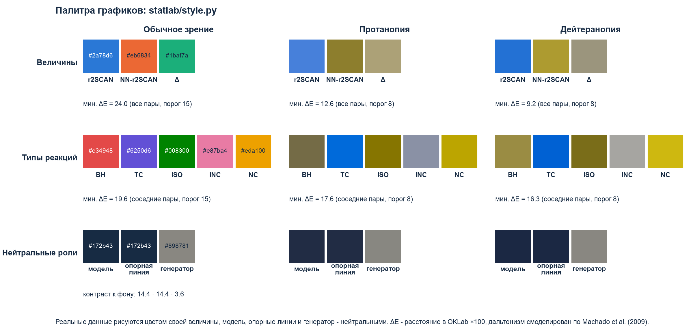
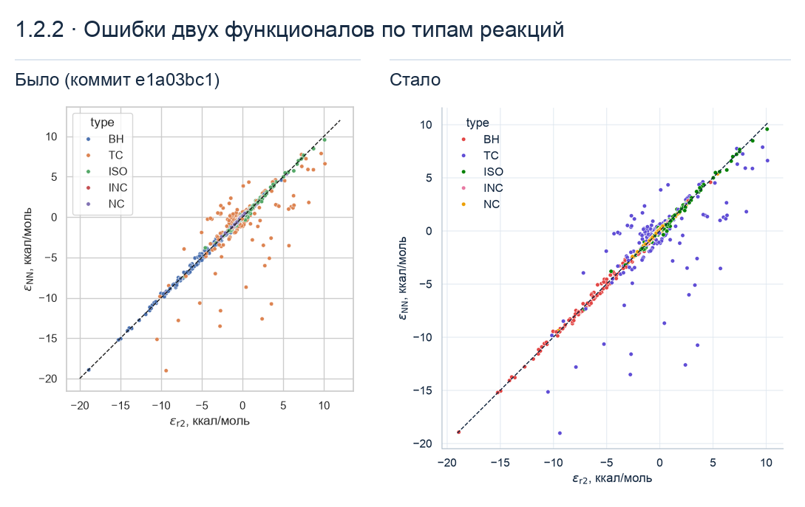
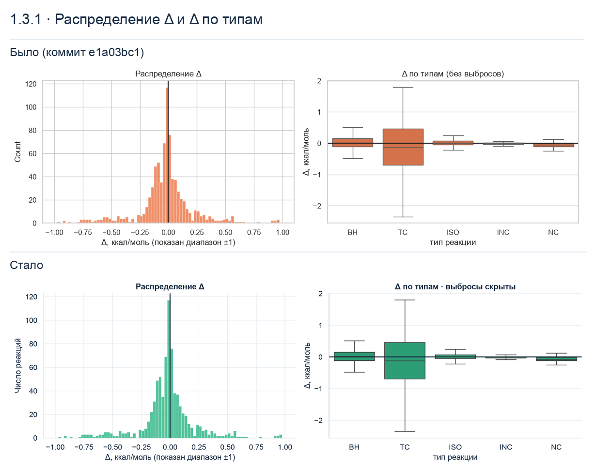
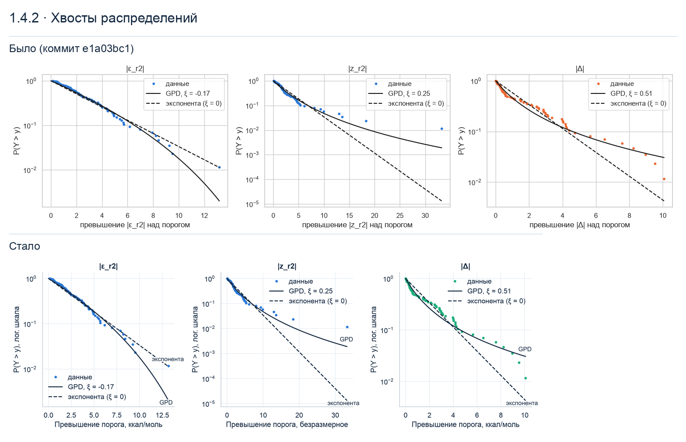
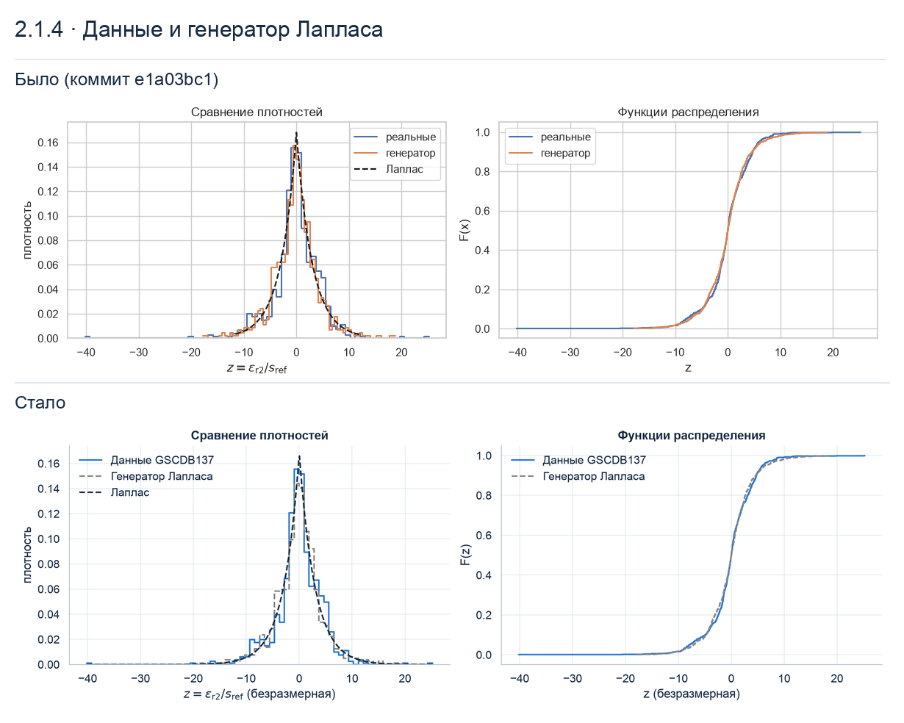

# Визуализация и доп. задание КТвД

Здесь собрана часть лабораторной, выполненная дизайнерами (КТвД). Анализ в `lab01.ipynb` сделан инфохимиками, а в этой части ноутбук приведён в порядок, для всех графиков сделан общий стиль и собрано интерактивное приложение на marimo.

## Как посмотреть

Проще всего скачать и открыть в браузере два файла из `export/`:

- [`lab01.html`](export/lab01.html) - ноутбук без кода, со всеми графиками;
- [`lab01_visual.html`](export/lab01_visual.html) - снимок marimo-приложения.

Они нужны, потому что GitHub не показывает интерактивные графики из ноутбука, а HTML вообще открывает как код.

Чтобы всё работало вживую, из корня репозитория:

```bash
pip install -r requirements.txt marimo
marimo run additional_task_ktvd/lab01_visual.py   # приложение
jupyter lab lab01.ipynb                           # ноутбук
```

## Что сделано

| Критерий КТвД | Что сделано | Готово? |
|---|---|---|
| Индексы разделов | все разделы пронумерованы: 1.1, 1.1.1, 2.1.4 и так далее | да |
| Якорные ссылки | оглавление в начале, ссылка на каждый раздел и «↑ К содержанию» в конце | да |
| Скрытие кода | весь код свёрнут, и в ноутбуке, и в marimo | да |
| Масштабы и единицы | единицы на всех осях; если ось обрезана, это подписано | почти, см. ниже |
| Единая стилистика | одна палитра и одно оформление на ноутбук и marimo | почти, см. ниже |
| Формулы в LaTeX | все формулы в LaTeX, обозначения везде одинаковые | да |

Доп. задание выполнено в [`lab01_visual.py`](lab01_visual.py):

| Требование | Что сделано | Готово? |
|---|---|---|
| Свой датасет и две величины | взяты опубликованные результаты 16 расчётных методов на базе GSCDB137 (Liang, Head-Gordon, 2025), это 6931 реакция. Величины - ошибки двух методов, которые выбираются в приложении | да |
| Доказать, что величина случайная | показано, что ошибку нельзя угадать даже по похожим реакциям из того же набора | да |
| Зависимость | проверена тремя способами (Пирсон, Спирмен, χ²) и показана на графиках: ошибки двух методов связаны | да |
| EDA | основные показатели, распределения, сравнение по типам реакций, редкие большие ошибки | да |
| Интерактивный генератор | выбор распределения и ползунки параметров; график и оценка похожести на данные сразу пересчитываются | да |

## Оформление графиков



- Один цвет - одна вещь. Синий - r2SCAN (в marimo метод A), оранжевый - NN-r2SCAN (метод B), бирюзовый - Δ, у типов реакций свои пять цветов.
- Настоящие данные рисуются цветом, а всё «придуманное» - нейтрально: теоретические кривые тёмно-синие, генератор серым пунктиром.
- Цвета проверены на дальтонизм: на картинке видно, как их различают люди с протанопией и дейтеранопией.
- Оси тихие: без лишней рамки, тонкая сетка, легенды без обводки. У графиков пара стандартных размеров, картинки чёткие на любом экране.
- Теоретические кривые подписаны прямо на графике, чтобы не приходилось искать их в легенде.

Всё это хранится в [`statlab/style.py`](../statlab/style.py): если поменять цвет там, он поменяется везде. После изменений нужно запустить `python additional_task_ktvd/build_assets.py`, он пересоберёт картинки и экспорт.

## Было и стало

Сверху или слева - ноутбук инфохимиков до оформления (коммит `e1a03bc1`), снизу или справа - текущая версия.






## Как шла работа

1. Сначала был оформлен ноутбук (оглавление, нумерация, скрытый код) и сделана первая версия marimo со своей палитрой.
2. Затем выяснилось, что цвета путаются: один и тот же синий обозначал и r2SCAN, и барьеры, а палитр в проекте было целых три. Всё было собрано в одну палитру в `style.py`.
3. После этого графики были отполированы и собрана эта папка: карточка палитры, «было/стало», экспорт.
4. Первая версия marimo просто пересказывала ноутбук, поэтому её переделали на отдельные данные, а тексты переписали проще.

## Что пока не доделано

- В ноутбуке пара графиков ещё не в общей палитре (точки по наборам в 1.1.1 и QQ-графики), а подписи осей местами с маленькой буквы.
- Пять типов реакций на одном scatter различаются хуже, чем хотелось бы. Различать их помогают легенда и подсказки при наведении.
- Выводы в marimo пока собираются из чисел автоматически, их нужно дописать своими словами.

## Про ИИ

С написанием`style.py`, `build_assets.py`, marimo-приложения, финализацией README помогал Claude (Claude Code)
